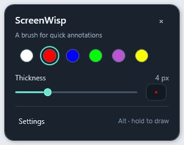
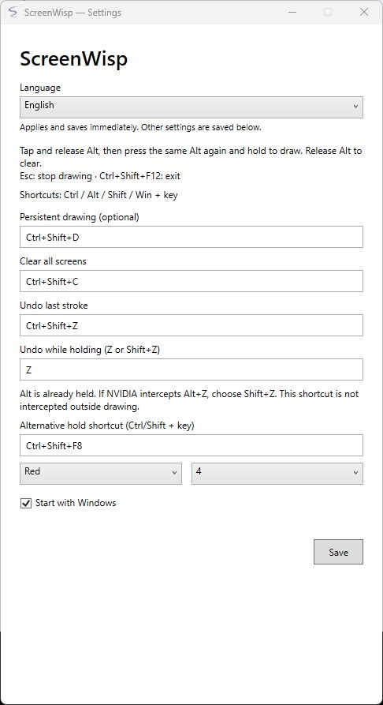

<p align="center"></p>

# ScreenWisp

[English](README.md) · [Русский](README.ru.md)

**Draw anywhere. Release Alt. Gone.**

Temporary screen annotations for Windows. Tap Alt, then hold Alt to draw over your desktop. Let go and every temporary stroke disappears. Your mouse goes straight back to normal.

Native C# / WPF. Multiple monitors. A tray icon instead of a floating toolbar. Open source under MIT.

> **1.0.0 RC3 — release candidate.** English and Russian are available, with Automatic Windows UI language detection and English fallback. Downloads are unsigned. Clean-machine and real Windows sign-in checks are still pending; see [validation and remaining checks](docs/RELEASE-VALIDATION.md).

## Download

| Package | Choose this when… |
|---|---|
| [ScreenWisp-Setup.exe](https://github.com/dontpalevo/ScreenWisp/releases/download/v1.0.0-rc.3/ScreenWisp-Setup.exe) | You want a regular per-user installation, a Start menu shortcut and an uninstaller. |
| [ScreenWisp-Portable.zip](https://github.com/dontpalevo/ScreenWisp/releases/download/v1.0.0-rc.3/ScreenWisp-Portable.zip) | You want to extract a folder and run the app without installing it. |
| [SHA256SUMS.txt](https://github.com/dontpalevo/ScreenWisp/releases/download/v1.0.0-rc.3/SHA256SUMS.txt) | Verify the exact downloaded bytes. |

[Download the RC3 pre-release](https://github.com/dontpalevo/ScreenWisp/releases/tag/v1.0.0-rc.3). This is an unsigned release candidate, not stable 1.0.0.

## Draw, explain, let go

| 1. Tap | 2. Hold | 3. Draw | 4. Release |
|---|---|---|---|
| Press and release Alt. | Press **the same Alt** again within **400 ms**, and keep it down. | Draw with the left mouse button on any connected monitor. Press **Z** to undo a finished stroke. | Release Alt. All temporary ink clears on all monitors, and the overlays become click-through. |

A single Alt tap does not start drawing. Undo is shared across monitors and removes one completed stroke per press; key autorepeat does not erase the whole history.

The screenshots below show the actual interface. A demonstration video is not included in this release.

## Small controls, out of the way



- **Left-click the tray icon:** pick a color, move the thickness slider and see the brush preview. Changes apply immediately and are saved.
- **Right-click:** Settings or Exit. Autostart is available only inside Settings.
- **Multiple monitors:** draw on any connected display without moving a toolbar. Each display has its own overlay; undo is shared.
- **Autostart:** enabled by default for a new profile, optional afterward. Startup is quiet, directly in the tray, using the current user's Windows startup registration.

<details>
<summary>Settings screenshot</summary>



</details>

These are captures of the real WPF interface on a neutral test desktop, not mockups. Screenshots show the real English UI. See [Russian UI](README.ru.md).

## Install

### Setup — recommended for a permanent location

1. Download `ScreenWisp-Setup.exe` and compare its SHA256 with `SHA256SUMS.txt`.
2. Exit a running ScreenWisp instance, then run Setup. Administrator rights are not required. The default location is `%LOCALAPPDATA%\Programs\ScreenWisp`.
3. Launch ScreenWisp from the installer or Start menu. Find its S-shaped icon in the tray; Windows may place it in the overflow area.
4. Open Settings to change autostart or shortcuts. A saved autostart preference is respected during updates.

To update, exit the app and run the newer installer over the existing installation. To uninstall, use Windows **Settings → Apps → Installed apps**. The uninstaller removes its shortcut and owned startup entry; user preferences are retained.

### Portable

1. Download and verify `ScreenWisp-Portable.zip`.
2. Extract the **whole archive** to a permanent writable folder. Do not run it inside the ZIP.
3. Run `ScreenWisp.exe`. No administrator rights or separate .NET installation are needed.

**Before moving or deleting the portable folder, disable autostart in Settings.** After moving, launch from the new path and enable it again. Launching manually at the new location also repairs the one saved registration. Windows cannot locate a moved EXE until you do this.

ScreenWisp registers the actual executable path; it does **not copy its own EXE** to another startup folder. Portable and installed editions share settings and one interactive-session instance. Portable means no installer; it still stores preferences and a diagnostic log in the user's profile. Exit before replacing files during an update.

### Language

In Settings, select English, Русский or Automatic. The preference saves immediately; other form edits remain until Save. Automatic uses Russian for a Russian Windows UI, English for all other languages. Shortcut notation and existing preferences are preserved. Windows-owned title-bar menus and dialog buttons follow Windows language.

### Verify a download

In PowerShell, from the folder containing the downloads:

```powershell
Get-FileHash .\ScreenWisp-Setup.exe -Algorithm SHA256
Get-FileHash .\ScreenWisp-Portable.zip -Algorithm SHA256
Get-Content .\SHA256SUMS.txt
```

Compare the full hash for the matching filename. A matching checksum confirms matching bytes; it does not establish publisher identity or replace a digital signature.

## Controls

| Default input | Action |
|---|---|
| Tap Alt, release, hold the same Alt again within 400 ms | Temporary drawing, until Alt is released |
| Z during temporary drawing — physically Alt+Z | Undo one completed temporary stroke, across all monitors |
| Esc | Stop drawing and clear temporary ink |
| Ctrl+Shift+F12 | Emergency exit |
| Ctrl+Shift+F8, hold | Alternative temporary drawing trigger; configurable |
| Ctrl+Shift+D | Optional persistent drawing mode |
| Ctrl+Shift+C | Clear the active drawing history |
| Ctrl+Shift+Z | Global undo |
| Shift while drawing | Constrain a stroke horizontally or vertically |

Persistent drawing has a separate history. It is hidden during temporary drawing and restored afterward; mouse interception does not resume automatically.

**NVIDIA Alt+Z:** ScreenWisp consumes its selected undo chord only during a temporary drawing session. Outside that session it does not intercept Alt+Z. If NVIDIA's hook takes priority, set temporary undo to **Shift+Z** in Settings, physically Alt+Shift+Z while drawing, or choose another unoccupied Ctrl/Shift chord. ScreenWisp does not change NVIDIA settings. Alt+Tab and other system chords pass through and end temporary drawing.

Left and right Alt are tracked separately. AltGr layouts that synthesize Ctrl+Alt do not activate the gesture; use left Alt or the alternative hold shortcut.

## Requirements and known limitations

- **Windows 10/11 x64**, interactive desktop. The installer requires Windows 10 build 17763 or later. The .NET 10 runtime is bundled. Broad OS compatibility is not yet certified.
- **Unsigned executables:** Windows SmartScreen, browsers or antivirus products may warn, block or quarantine a download. There is no promise of warning-free installation. Do not disable protection or add exclusions to make the app run; report the detection and exact version/hash for investigation.
- RC1's confirmed Kaspersky behavior detection was caused by startup EXE self-copying. RC2 removes that behavior. Corrected local portable and installer runs produced no corresponding new detections in the inspected reports; that is not universal antivirus clearance.
- A stroke belongs to the monitor where it starts. Release the mouse and start a separate stroke on the next monitor. Display geometry/DPI changes or disconnection clear affected ink.
- UAC secure desktop, the lock screen and exclusive fullscreen are not supported. Ink is not saved between app sessions.
- Temporary drawing fails closed after 120 seconds. A watchdog checks missed releases and desktop/session changes; cleanup still depends on a responsive UI dispatcher. Esc and the emergency exit provide additional escape routes.
- English / Русский / Automatic apply immediately in Settings without restarting. No screenshot capture, cloud sync, account, in-app AI or automatic update service is included.
- Clean Windows 10/11 VM tests and an actual Windows sign-out/sign-in autostart test remain open. See [recorded validation](docs/RELEASE-VALIDATION.md).

## Data and trust

Settings: `%APPDATA%\ScreenWisp\settings.json`. Logs: `%LOCALAPPDATA%\ScreenWisp\logs\app.log`. Gesture diagnostics record Alt state transitions and hook errors, not typed text or unrelated key codes. The app makes no network requests. Review logs for personal paths before sharing them.

Development used **OpenAI Codex**. ScreenWisp builds on existing MIT-licensed Desktop Ink code rather than claiming an entirely original implementation. Physical keyboard behavior is distinct from synthetic test input; test counts are not a substitute for a real desktop run.

## Source and development

See [localization/DPI checks](docs/LOCALIZATION.md), [build instructions](docs/DEVELOPMENT.md), [architecture](docs/PUBLIC-ARCHITECTURE.md) and [validation](docs/RELEASE-VALIDATION.md). The repository includes a reviewed source set; build products, user logs and private diagnostics do not belong in the public repository. No script publishes to GitHub.

## License and credits

ScreenWisp is derived from [Desktop Ink](https://github.com/atman-33/desktop-ink) by **atman-33**, under MIT. The original [MIT LICENSE](LICENSE), including its 2026 copyright notice, is preserved verbatim. [THIRD-PARTY-NOTICES.md](THIRD-PARTY-NOTICES.md) records the reused code and baseline commit. ScreenWisp changes are also distributed under MIT. Bundled .NET runtime license notices are included in the download packages.

The approved ScreenWisp S-shaped disappearing stroke and transparent icons are in [branding/](branding/).


[ScreenWisp authorship and notices](COPYRIGHT.md). Original additions © 2026 dontpalevo; original Desktop Ink copyright remains atman-33. See [MIT for ScreenWisp additions](LICENSE-SCREENWISP).
