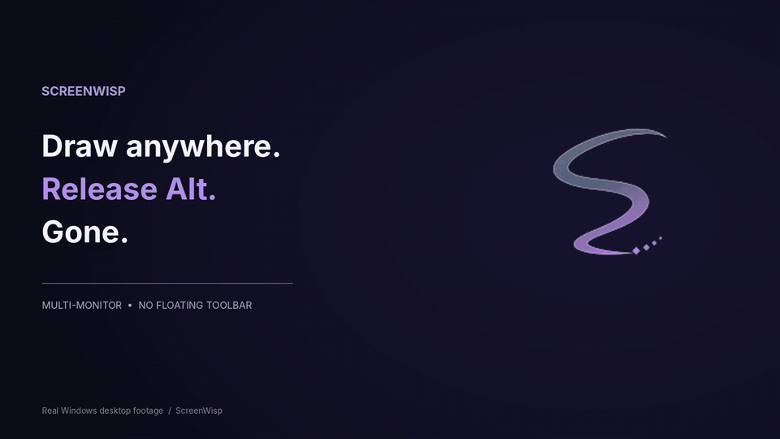
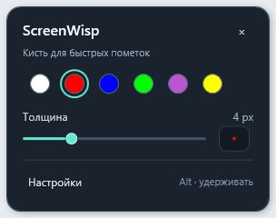
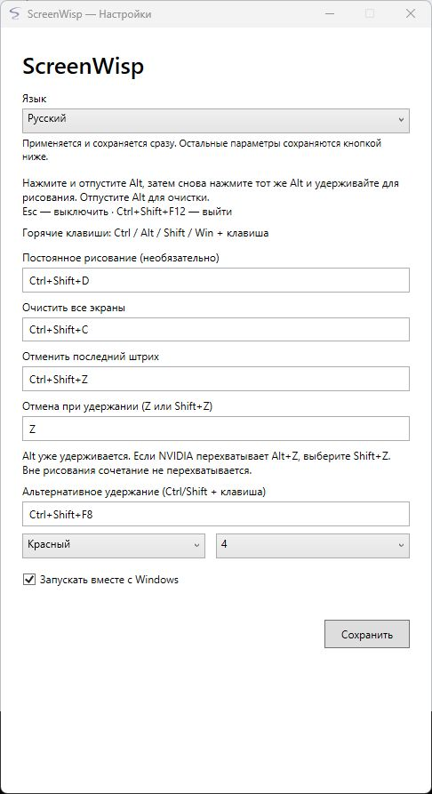

# ScreenWisp

[English](README.md) · [Русский](README.ru.md)

**Draw anywhere. Release Alt. Gone.**

**Покажите, что важно. Объясните. Продолжайте работу.** ScreenWisp позволяет рисовать временные пометки поверх рабочего стола Windows во время онлайн-уроков, трансляций, презентаций и демонстраций экрана — без скриншотов и постоянно висящей панели.

Нажмите и отпустите Alt, затем быстро нажмите тот же Alt ещё раз и удерживайте для рисования. **Отпустите Alt — все пометки мгновенно исчезнут**, а мышь вернётся к обычной работе. Поддерживается несколько мониторов.

Бесплатно · Открытый код (MIT) · Windows 10/11 x64 · Русский и английский

[**Скачать ScreenWisp**](https://github.com/dontpalevo/ScreenWisp/releases/tag/v1.0.0-rc.3)

## Кому пригодится

- **Учителям и репетиторам:** обвести формулу, подчеркнуть предложение или указать на деталь во время онлайн-занятия.
- **Стримерам и авторам видео:** выделять важное на рабочем столе во время объяснения и сразу убирать пометки. Проверьте, захватывает ли ваша программа трансляции оверлеи.
- **Ведущим презентаций и встреч:** привлекать внимание к графикам, слайдам, цифрам и элементам интерфейса.
- **Разработчикам:** показывать строки кода, ошибки и элементы интерфейса при совместной работе и код-ревью.
- **Техподдержке:** быстро показывать, куда нажать и какую настройку изменить.
- **Всем, кто объясняет что-то с экрана:** нарисовать круг, подчёркивание или указатель вместо долгих слов.

Нативная программа на C# / WPF живёт в трее: небольшая панель кисти при необходимости и никакого постоянного тулбара.

**v1.0.0-rc.3 — предварительный выпуск.** EXE не подписаны; проверки на чистых Windows и реального автозапуска после входа ещё открыты.

## Как рисовать

1. Нажмите и отпустите Alt.
2. Не позднее 400 мс нажмите тот же Alt ещё раз и удерживайте.
3. Рисуйте левой кнопкой мыши на любом мониторе. Z отменяет последний завершённый штрих; история общая.
4. Отпустите Alt: всё временное рисование исчезнет, слои станут click-through.

Одиночный Alt не активирует рисование. Переходя на другой монитор, отпустите кнопку мыши и начните новый штрих. Ниже показаны реальные окна интерфейса.

## Интерфейс и язык

- ЛКМ по значку: цвет, толщина и предпросмотр кисти; выбор сразу сохраняется.
- ПКМ: Настройки и Выход. Автозапуск настраивается только в окне настроек.
- English, Русский, Автоматически: выбор сохраняется и применяется сразу. Остальные поля открытой формы не теряются.
- Автоматически: русский для русского интерфейса Windows; английский для остальных языков.
- Системные меню заголовка и стандартные кнопки диалогов принадлежат Windows и используют язык ОС.

## Установка и Portable

Скачайте [ScreenWisp-Setup.exe](https://github.com/dontpalevo/ScreenWisp/releases/download/v1.0.0-rc.3/ScreenWisp-Setup.exe) и запустите его. Права администратора и отдельный .NET не нужны. Установка для текущего пользователя, ярлык в Пуск, удаление через Параметры Windows → Приложения. Перед обновлением закройте приложение и установите новую версию поверх. Настройки при удалении сохраняются.

Portable: полностью распакуйте [ScreenWisp-Portable.zip](https://github.com/dontpalevo/ScreenWisp/releases/download/v1.0.0-rc.3/ScreenWisp-Portable.zip) в постоянную папку и запустите ScreenWisp.exe. Не запускайте внутри ZIP. Перед переносом или удалением выключите автозапуск; после переноса запустите EXE и включите его снова. Самокопирования EXE нет: регистрируется текущий путь. Portable сохраняет настройки и журнал в профиле пользователя. Установленная и portable-версии используют один экземпляр на интерактивный сеанс.

## Управление

| По умолчанию | Действие |
|---|---|
| Alt → отпустить → тот же Alt удерживать | Временное рисование |
| Z при удерживаемом Alt | Отмена одного штриха, физически Alt+Z |
| Esc | Отключить рисование, очистить временные линии |
| Ctrl+Shift+F12 | Аварийный выход |
| Ctrl+Shift+F8, удерживать | Альтернативное удержание |
| Ctrl+Shift+D | Необязательное постоянное рисование |
| Ctrl+Shift+C | Очистить активную историю |
| Ctrl+Shift+Z | Глобальная отмена |
| Shift при рисовании | Горизонтальная или вертикальная линия |

Истории постоянного и временного рисования раздельные. Автоповтор Z не стирает всё. Вне рисования Alt+Z не перехватывается. При конфликте с NVIDIA выберите Shift+Z для отмены: физически Alt+Shift+Z. Alt+Tab проходит в систему и завершает временную сессию. AltGr не активирует жест; используйте левый Alt или альтернативу.

## Требования и ограничения

Windows 10/11 x64, интерактивный рабочий стол; минимум установщика — сборка 17763. .NET 10 входит в пакеты. EXE не подписаны: возможны предупреждения SmartScreen, браузера и антивируса. Не отключайте защиту и не добавляйте исключения ради запуска. Сообщайте точное обнаружение, версию и SHA256.

Самокопирование EXE, вызвавшее Kaspersky в RC1, устранено в RC2 и не возвращено в RC3. Локальный запуск не гарантирует совместимость со всеми антивирусами. UAC secure desktop, экран блокировки и эксклюзивный fullscreen не поддерживаются. Изменение дисплея очищает затронутые линии. Временная сессия ограничена 120 секундами; watchdog зависит от отзывчивости UI.

Нет захвата экрана, облака, аккаунтов, встроенного AI или автообновлений. Сетевые запросы не выполняются. Настройки: %APPDATA%\ScreenWisp\settings.json. Журнал: %LOCALAPPDATA%\ScreenWisp\logs\app.log; посторонний набранный текст не записывается. Перед отправкой журнала проверяйте личные пути.

SHA256 новых пакетов: [SHA256SUMS.txt](https://github.com/dontpalevo/ScreenWisp/releases/download/v1.0.0-rc.3/SHA256SUMS.txt). В PowerShell используйте Get-FileHash с -Algorithm SHA256; сравните полную строку для нужного файла. Хеш не заменяет подпись издателя.

[Локализация и DPI](docs/LOCALIZATION.md) · [Приёмка](docs/RELEASE-VALIDATION.md) · [Сборка](docs/DEVELOPMENT.md).

## Открытый код и авторство

ScreenWisp — бесплатная программа с открытым кодом под лицензией MIT. Собственные доработки © 2026 **dontpalevo**.

[Лицензия для доработок](LICENSE-SCREENWISP) · [Исходная MIT-лицензия](LICENSE) · [Уведомления о стороннем коде](THIRD-PARTY-NOTICES.md) · [Авторство](COPYRIGHT.md)

Основа проекта и благодарности

ScreenWisp использует код [Desktop Ink](https://github.com/atman-33/desktop-ink) автора **atman-33** под MIT. Оригинальные уведомления об авторстве и лицензии сохранены. Уведомления .NET входят в пакеты. В разработке использовался OpenAI Codex.

